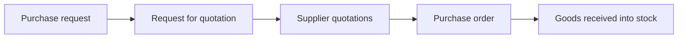
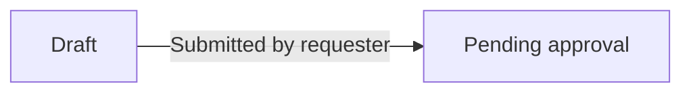
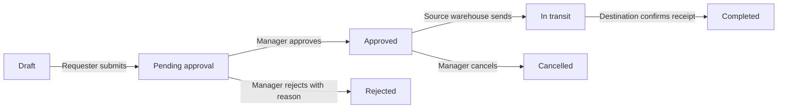
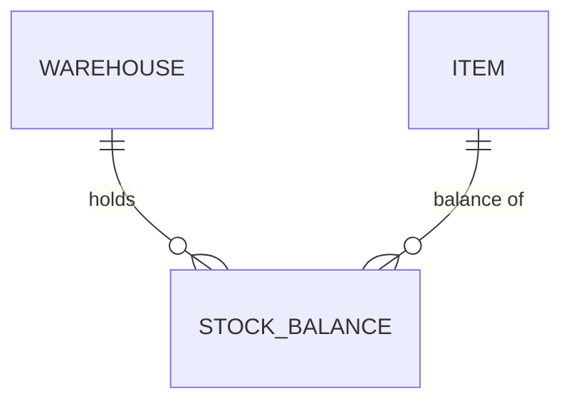
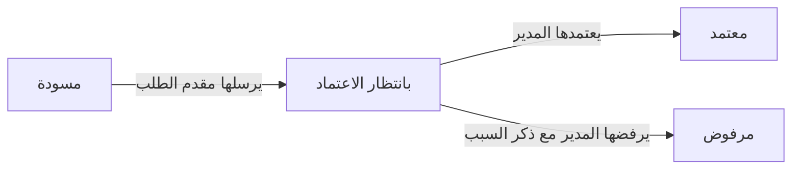

# Output templates

Two kinds of files:
- **Business** (`en/business/`, `ar/business/`): written for business owners. No file paths, no code words, no backticks. Real screen labels, real numbers.
- **Technical** (`technical/`): written for developers. Citations (`file:line`), field names, mismatches.

Keep the section order. If a section doesn't apply, write one sentence saying why — never leave it empty.

## Contents
- README.md
- Business: executive summary · business processes · feature card (template + full example) · who can do what · open questions & risks · glossary
- Technical: data model · permission matrix · validation reconciliation · traceability · findings & gaps
- Arabic version: glossary of headings + Arabic feature card example

---

## README.md (`docs/business-analysis/README.md`)

````markdown
# <System name> — Business Analysis / التحليل الوظيفي

Generated: <YYYY-MM-DD> · Commit: <short hash or "n/a"> · Repos analyzed: <frontend repo>, <backend repo>

## For business owners / لأصحاب العمل
| Document | English | العربية |
|---|---|---|
| Executive summary / الملخص التنفيذي | [Read](en/business/01-executive-summary.md) | [اقرأ](ar/business/01-executive-summary.md) |
| Business processes / العمليات | [Read](en/business/02-business-processes.md) | [اقرأ](ar/business/02-business-processes.md) |
| Features: <Module> / الخصائص: <الوحدة> | [Read](en/business/03-features/<module>.md) | [اقرأ](ar/business/03-features/<module>.md) |
| Who can do what / الصلاحيات | [Read](en/business/04-who-can-do-what.md) | [اقرأ](ar/business/04-who-can-do-what.md) |
| Open questions & risks / أسئلة ومخاطر | [Read](en/business/05-open-questions-and-risks.md) | [اقرأ](ar/business/05-open-questions-and-risks.md) |
| Glossary / المصطلحات | [Read](en/business/06-glossary.md) | [اقرأ](ar/business/06-glossary.md) |

## Coverage
[Feature ledger](feature-ledger.md) — every screen and backend operation found in the code, and the feature that covers it.

## For developers
[Data model](technical/data-model.md) · [Permission matrix](technical/permission-matrix.md) · [Validation](technical/validation-reconciliation.md) · [Traceability](technical/traceability.md) · [Findings & gaps](technical/findings-and-gaps.md)
````

---

## Business files

### 01-executive-summary.md

````markdown
# <System name> — Executive Summary

## What the system is
<One paragraph: the business it serves, who uses it daily, the problem it solves.>

## What the system covers
| Area | What it lets the business do | Features |
|---|---|---|
| Purchasing | Request items, collect supplier quotations, compare them, issue purchase orders | F07–F11 |

## Main business processes
1. **<Process name>** — <one sentence from start to finish>. See *Business processes*.

## Users and roles
<2–4 sentences: the kinds of users, how access is granted (fixed roles or configurable permissions), and data separation between companies/branches.>

## Key numbers
| Modules | Features | Roles / permission groups | Forms | Approval workflows | Open questions |
|---|---|---|---|---|---|
| 6 | 34 | 5 | 27 | 9 | 12 |

## Top points for management attention
1. <Most important risk or gap in business terms — e.g. "Stock can be issued without a manager approval when …">
2. …
````

### 02-business-processes.md

````markdown
# Business Processes

## Process: <Name> (e.g. Procure to stock)
**Goal:** <business outcome>
**Starts when:** <trigger> · **Ends when:** <final outcome>



| Step | Who | What they do | Document produced | Feature |
|---|---|---|---|---|
| 1 | Department employee | Requests the items they need | Purchase request | F07 |

**Business rules along the way:** <rules that span steps>
**Where it can stop:** <rejections, cancellations and what happens then>
````

### Feature card (inside `03-features/<module>.md`)

Each module file starts with a short introduction (what the module is for, its features in a table), then one card per feature.

````markdown
# <Module name>

<2–3 sentences about the module's role in the business.>

| ID | Feature | Used by |
|---|---|---|
| F12 | Stock transfer request | Warehouse keepers, branch managers |

---

## F12 · <Feature name as users see it>

### What it is
<2–4 sentences: what it does and why it matters to the business.>

### Who uses it
- **<Role>** — <what they do in this feature>
- **<Role>** — view only

### When it's used
<The business situation that triggers it.>

### How it works
1. <Step from the user's point of view, using real screen and button names>
2. …

### Information required
| Field | Required | Meaning and rules |
|---|---|---|
| <UI label> | Yes / No / Only when … | <What to enter, allowed values, limits, defaults> |

### Business rules
- <Plain sentence with real numbers and conditions>

### Approvals and statuses
<Lifecycle in plain words.>



| Status | Meaning | Who moves it forward | Next possible statuses |
|---|---|---|---|

### What happens next
- <Effect on stock / money / other modules / notifications / generated documents>

### Reports and outputs
- <Printouts, exports, dashboards>

### Notes and limitations
- <Missing, risky, or needs confirmation — also listed in Open questions>
````

### Feature card — full example (ILLUSTRATIVE ONLY)

> This example uses **invented** values to show the expected depth and tone. Never copy its facts; every statement in a real report must come from the analyzed code.

````markdown
## F12 · Stock transfer request

### What it is
A stock transfer request moves items from one warehouse to another — for example, from the main warehouse to a branch that is running low. It keeps a record of who asked for the items, who approved the move, and exactly what left one warehouse and arrived at the other, so stock balances stay correct in both places.

### Who uses it
- **Branch warehouse keeper** — creates the request and confirms receipt.
- **Main warehouse keeper** — prepares and sends the items.
- **Inventory manager** — approves or rejects the request.
- **Accountants** — can view requests and their history but cannot change them.

### When it's used
When a warehouse needs items that are available in another warehouse of the same company, instead of buying them from a supplier.

### How it works
1. The branch warehouse keeper opens **Warehouse requests → New transfer request**.
2. They choose the **source warehouse** (where the items are) and the **destination warehouse** (where they are needed).
3. They add the items, the quantity, and the unit (e.g. box or piece) for each line, and can add a note explaining the reason.
4. They press **Submit**. The request receives an automatic number such as TR-2026-00045 and goes to the inventory manager for approval.
5. The inventory manager reviews the request and approves it, or rejects it with a reason.
6. After approval, the main warehouse keeper prepares the items and issues a **transfer permit**; the items leave the source warehouse.
7. The branch warehouse keeper confirms receipt; the items are added to the destination warehouse.

### Information required
| Field | Required | Meaning and rules |
|---|---|---|
| Source warehouse | Yes | Only warehouses of the user's company are listed. |
| Destination warehouse | Yes | Must be different from the source warehouse. |
| Request date | Yes | Defaults to today; cannot be in the future. |
| Item | Yes (at least one line) | Only active items can be chosen. |
| Quantity | Yes | Must be greater than zero and cannot exceed the available balance in the source warehouse. |
| Unit | Yes | The item's basic unit or one of its derived units; quantities are converted automatically. |
| Notes | No | Free text, up to 500 characters. |

### Business rules
- A request must contain at least one item.
- The same item cannot appear twice in one request.
- Requests above 50 lines need a second approval from the general manager.
- Once approved, a request can no longer be edited — only cancelled by the inventory manager.

### Approvals and statuses
A request starts as a draft, waits for the inventory manager, and after approval is completed in two physical steps: sending and receiving.



| Status | Meaning | Who moves it forward | Next possible statuses |
|---|---|---|---|
| Draft | Being prepared, not visible to approvers | Requester | Pending approval |
| Pending approval | Waiting for a decision | Inventory manager | Approved, Rejected |
| Approved | Allowed to be sent | Main warehouse keeper / manager | In transit, Cancelled |
| In transit | Items left the source warehouse | Branch warehouse keeper | Completed |
| Completed | Items received; balances updated | — | — |
| Rejected / Cancelled | Closed without moving stock | — | — |

### What happens next
- When sent: the source warehouse balance decreases.
- When received: the destination warehouse balance increases.
- The requester is notified when the request is approved or rejected.
- Every action is recorded in the request's history (who, what, when).

### Reports and outputs
- Printable transfer permit (PDF).
- The request appears in the item card movement history of both warehouses.

### Notes and limitations
- Partial receipt (receiving fewer items than sent) is not supported.
- The reason for the 50-line limit is not stated in the system — to confirm with the business.
````

### 04-who-can-do-what.md

````markdown
# Who Can Do What

## How access works
<Plain explanation: fixed roles or configurable permissions; who assigns them; separation between companies/branches; what a user sees when not allowed.>

## Roles
| Role | Typical job | Main responsibilities |
|---|---|---|

## Access summary
Legend: ✅ can do · 👁 view only · ❌ no access · 🔸 with conditions (see note)

| Area / action | <Role 1> | <Role 2> | <Role 3> |
|---|---|---|---|
| Create transfer request | ✅ | ✅ | ❌ |
| Approve transfer request | ❌ | 🔸¹ | ✅ |

¹ <condition in plain words>

## What each user can see
<Data separation rules: e.g. "Users only see documents of the companies they are assigned to.">
````

### 05-open-questions-and-risks.md

````markdown
# Open Questions and Risks

## Risks for the business
| # | Risk | Impact | Related feature |
|---|---|---|---|
| R1 | <plain description> | High / Medium / Low | F12 |

## Questions to confirm with the business
| # | Question | Why it matters | Related feature |
|---|---|---|---|

## Not covered by this report
<Areas not analyzed and why, in plain words.>
````

### 06-glossary.md

````markdown
# Glossary
| Term | Meaning in this system |
|---|---|
| Derived unit | A larger or smaller packing of the same item, e.g. a box of 12 pieces |
````

---

## Technical files (English)

### technical/data-model.md

````markdown
# Data Model



## Entities
### <Entity> (`table_name`) — `path/to/model:line`
| Field | Type | Required | Unique | Default | Notes |
|---|---|---|---|---|---|

## Statuses / enums
| Enum | Values | Used by | Source |
|---|---|---|---|
````

### technical/permission-matrix.md

````markdown
# Permission Matrix

## Mechanism
<Where permissions are defined, checked in backend, checked in frontend, data scopes — with citations.>

| Permission key | Module | Action | Roles (default/seeded) | Backend check | Frontend check |
|---|---|---|---|---|---|
| `inventory.transfer.approve` | Inventory | Approve transfer | manager | `TransferResolver.ts:88` | `useHasPermission` in `TransferPage.tsx:40` |

## Frontend-only checks ⚠️
| Action | Frontend check | Backend check | Risk |
|---|---|---|---|
````

### technical/validation-reconciliation.md

````markdown
# Validation Reconciliation

## Form: <name> (F12) — FE `path:line` · BE `path:line` · Table `name`
| Field | Name | Required FE | Required BE | Required DB | FE rules | BE rules | Mismatch |
|---|---|---|---|---|---|---|---|
````

### technical/traceability.md

````markdown
# Traceability

| ID | Statement (short) | Evidence |
|---|---|---|
| F12 | Stock transfer request feature | `src/routes/inventoryRoutes.tsx:24`, `api/src/transfer/transfer.resolver.ts:15` |
| F12-BR3 | Over 50 lines needs second approval | `api/src/transfer/transfer.service.ts:120` |
| F12-ST | Statuses and transitions | `api/src/transfer/transfer-status.enum.ts:3` |
````

### technical/findings-and-gaps.md

````markdown
# Findings & Gaps

| # | Type | Description | Location | Severity |
|---|---|---|---|---|

Types: Security · Validation mismatch · Inconsistent rule · Dead code · Hardcoded value · Missing workflow transition · TODO/FIXME

## Coverage
| Area | Status | Notes |
|---|---|---|
````

---

## Arabic version

`ar/business/` mirrors `en/business/` exactly: same files, same feature IDs, same rows. Prefer the Arabic labels from the project's translation files; otherwise use this glossary so wording stays consistent.

### Headings

| English | العربية |
|---|---|
| Executive Summary | الملخص التنفيذي |
| What the system is | ما هو النظام |
| What the system covers | ما يغطيه النظام |
| Main business processes | العمليات الرئيسية |
| Users and roles | المستخدمون والأدوار |
| Key numbers | أرقام رئيسية |
| Top points for management attention | أهم النقاط التي تحتاج انتباه الإدارة |
| Business Processes | العمليات |
| Goal / Starts when / Ends when | الهدف / تبدأ عندما / تنتهي عندما |
| Step / Who / What they do / Document produced | الخطوة / المسؤول / ما يقوم به / المستند الناتج |
| Where it can stop | متى يمكن أن تتوقف |
| What it is | ما هي هذه الخاصية |
| Who uses it | من يستخدمها |
| When it's used | متى تُستخدم |
| How it works | كيف تعمل |
| Information required | البيانات المطلوبة |
| Field / Required / Meaning and rules | الحقل / إلزامي / المعنى والقواعد |
| Yes / No / Only when … | نعم / لا / فقط عندما … |
| Business rules | قواعد العمل |
| Approvals and statuses | الاعتمادات والحالات |
| Status / Meaning / Who moves it forward / Next possible statuses | الحالة / المعنى / من ينقلها للخطوة التالية / الحالات التالية الممكنة |
| What happens next | ماذا يحدث بعد ذلك |
| Reports and outputs | التقارير والمخرجات |
| Notes and limitations | ملاحظات وقيود |
| Who Can Do What | من يستطيع أن يفعل ماذا |
| How access works | كيف تعمل الصلاحيات |
| Role / Typical job / Main responsibilities | الدور / الوظيفة / المسؤوليات الرئيسية |
| Legend: ✅ can do · 👁 view only · ❌ no access · 🔸 with conditions | المفتاح: ✅ مسموح · 👁 عرض فقط · ❌ غير مسموح · 🔸 بشروط |
| What each user can see | ما يراه كل مستخدم |
| Open Questions and Risks | أسئلة مفتوحة ومخاطر |
| Risk / Impact / Related feature | الخطر / التأثير / الخاصية المرتبطة |
| High / Medium / Low | عالي / متوسط / منخفض |
| Question / Why it matters | السؤال / لماذا هو مهم |
| Not covered by this report | ما لم يغطه هذا التقرير |
| Glossary / Term / Meaning in this system | المصطلحات / المصطلح / معناه في هذا النظام |

### Arabic feature card example (ILLUSTRATIVE ONLY — same invented example, shortened)

````markdown
## F12 · طلب تحويل مخزني

### ما هي هذه الخاصية
طلب التحويل المخزني ينقل أصنافاً من مخزن إلى مخزن آخر، مثلاً من المخزن الرئيسي إلى فرع نقص لديه المخزون. يحفظ الطلب سجلاً بمن طلب الأصناف ومن اعتمد النقل وما خرج من مخزن ودخل إلى الآخر، حتى تبقى أرصدة المخزنين صحيحة.

### من يستخدمها
- **أمين مخزن الفرع** — ينشئ الطلب ويؤكد الاستلام.
- **مدير المخزون** — يعتمد الطلب أو يرفضه.

### كيف تعمل
1. يفتح أمين مخزن الفرع **طلبات المخازن ← طلب تحويل جديد**.
2. يختار **المخزن المصدر** و**المخزن المستلم**.
3. يضيف الأصناف والكمية والوحدة لكل سطر.
4. يضغط **إرسال**، فيحصل الطلب على رقم تلقائي ويذهب لمدير المخزون للاعتماد.

### البيانات المطلوبة
| الحقل | إلزامي | المعنى والقواعد |
|---|---|---|
| المخزن المصدر | نعم | تظهر فقط مخازن شركة المستخدم. |
| الكمية | نعم | أكبر من صفر ولا تتجاوز الرصيد المتاح في المخزن المصدر. |

### الاعتمادات والحالات

````

Notes:
- Keep feature and rule IDs (F12, R1) unchanged in Arabic.
- Markdown viewers set direction per paragraph, so Arabic renders right-to-left without HTML wrappers. Don't add `<div dir="rtl">` unless the user asks.
